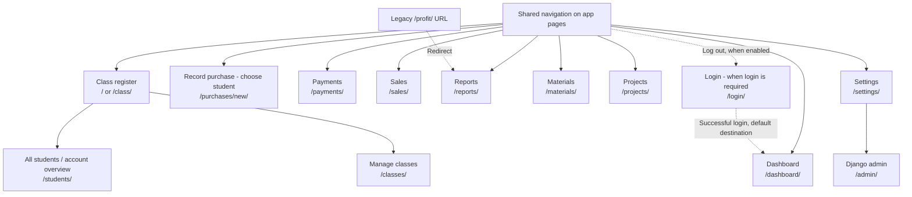
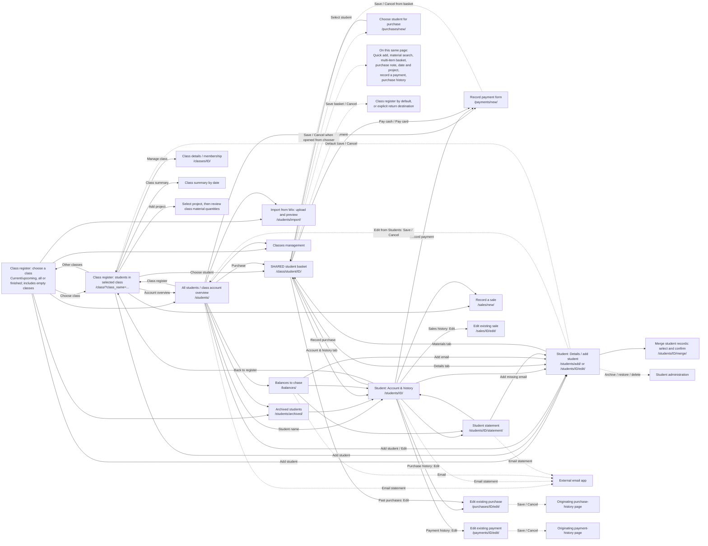
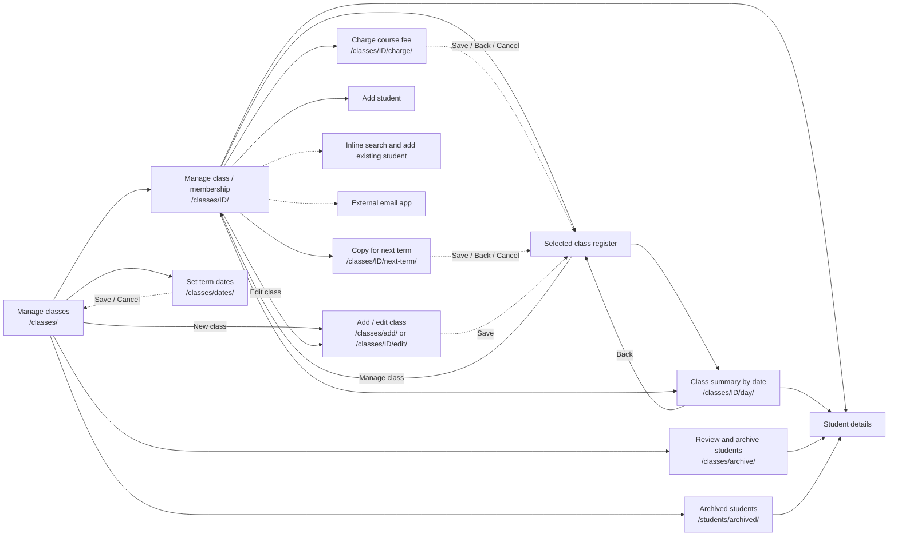
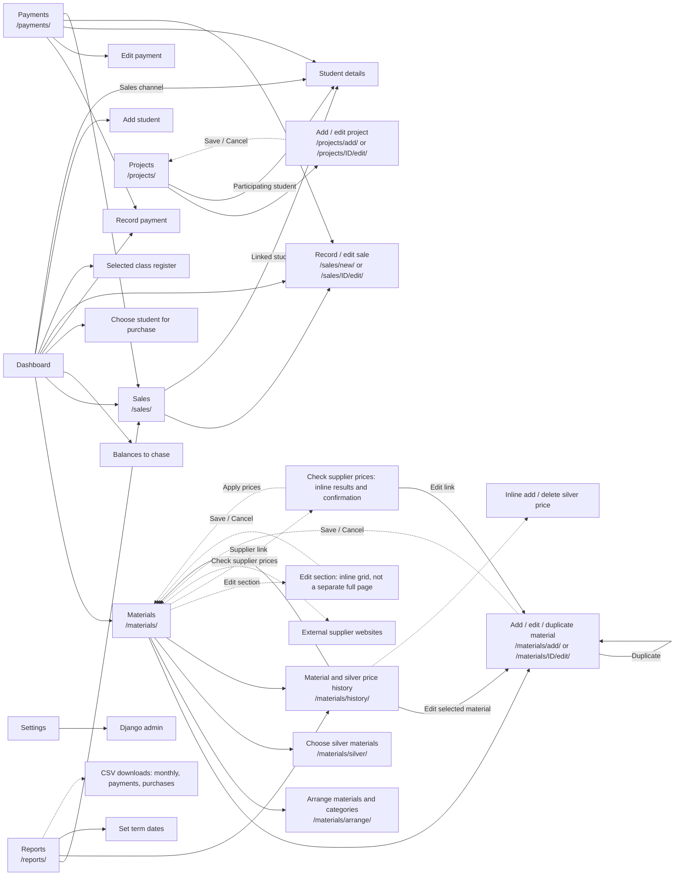

# Studio page map

Verified against the app routes and templates on 15 November 2026.

Mermaid is a good fit for this map: it is editable text, can live alongside the
code, and renders on GitHub and in Markdown viewers with Mermaid support.
The map is split into connected sections to avoid one unreadably large graph.
Repeated page names refer to the same page, not duplicate implementations.
The PNG is an older export; this Mermaid source reflects the unified register.

**Legend:** solid arrows are links to pages; dotted arrows are in-page features,
external destinations, or return paths as labelled. Add/edit screens sharing a
form are grouped. Filters, tabs and selected dates are states of a page, not
separate pages. The shared menu is shown once rather than repeated everywhere.

## 1. Shared menu and main pages

The signed-in app pages share this menu. The logo also returns to Class register.

## 2. Students, class register and purchases

**All students → Purchase**, **Account & history → Record purchase**, and
**Class register → Class → Student** all open the **same shared basket**.
The main menu's **Record purchase** asks you to select a student, then opens
the same basket. Existing purchases retain their individual edit form.

- Cash and card links open one payment form, with the method selected and the
  amount blank. The form has £5, £10 and £20–£100 amount shortcuts (in £10 steps);
  Save confirms.
- Both links are available for students with debt, zero balance or credit.
- The basket has one purchase note copied to every new basket item. Its payment
  notes are separate.
- Return destinations use the validated `next` parameter where provided.
  For example, All students' Purchase button returns to that student's register,
  while Edit preserves the current account-overview filter.
- Student pages share Materials, Account & history and Details tabs.
  Default saves return to the relevant register; archived students and sales
  channels retain their own reachable overview. Not every return arrow is drawn.

## 3. Class administration

Class administration is a subordinate part of Class register; the working
forms remain separate so their existing behaviour and data are preserved.

## 4. Materials, finance, projects and settings

## Background work and non-page actions

These are intentionally not drawn as ordinary pages:

- **Daily online-price refresh:** the first signed-in app visit starts a
  background update; the shared banner polls an HTML status fragment. Its
  Materials link returns to the materials page.
- **Daily silver-rate check** and **daily backup:** background/server work.
- **HTMX fragments:** student balance, material search, price previews, supplier
  fetch results, grid price cells, candidate students and filtered table rows.
- **POST actions:** delete, archive/restore, reorder, Quick add toggle, deliberate
  low-markup acknowledgement, adding students to a class, price application,
  payments, and Undo. They update data and/or return to a page.
- The legacy `settle_up` endpoint still exists, but neither current cash nor card
  button uses it. Both now open the normal payment form.
- Django admin is represented as one destination; its generated model screens
  are not expanded here.

## Source of truth

- [App routes](tracker/urls.py)
- [Login and admin routes](studio/urls.py)
- [Shared menu](tracker/templates/base.html)
- [Page templates](tracker/templates/tracker/)
- [Views and return navigation](tracker/views.py)

This is a manually maintained navigation map, not a generated route listing.
Update it when adding pages or changing their links.
